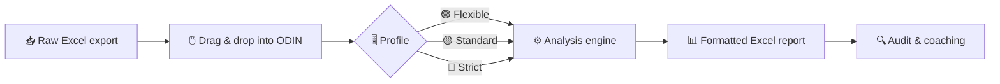

# ODIN
ODIN (Operational Dashboards for Integrated Networks) is a Windows desktop app that turns raw operations Excel exports into formatted, ready-to-review reports. It covers contact behavior deep dives, schedule adherence infractions and the Flex ScoreCard.

# 🛡️ ODIN
### Operational Dashboards for Integrated Networks

**From raw Excel exports to audit-ready reports in seconds** ⚡

---

## 🎯 What is ODIN?

ODIN is a desktop app for **operations teams** that replaces manual Excel macros and scripts with a simple **point-and-click** workflow.

> 🖱️ Drop in a raw export → 🎚️ pick a strictness level → 📊 get a formatted Excel report.
> No Python or Excel skills needed.

---

## 🔄 How it works

---

## 📊 Dashboards

| | Dashboard | What it does |
|:-:|---|---|
| ☎️ | **Deep Dive · Contacts** | Flags contacts with possible mishandling: intentional disconnects, hold avoidance, high ACHT, long answer times, declined transfers and more. Color-coded by severity, with a per-agent summary and a behavior heatmap. |
| ⏱️ | **Status Auxiliaries · Infractions** | Compares activity punches against each associate's schedule to catch **no-shows**, **late arrivals**, **early departures** and **excess Break/Personal** time. |
| ⭐ | **Flex ScoreCard** | Combines several metric sources into one **weighted scorecard** per associate, with 🟢🟡🔴 targets. |

---

## ✨ Highlights

- 🎚️ **Configurable thresholds**: Flexible, Standard and Strict profiles that managers can tune and export
- 👥 **Schedule management**: load associates from Excel, or ➕ add, ✏️ edit and 🗑️ remove them in the app
- 🖱️ **Drag & drop** file input
- 🌗 **Light & dark mode**
- 🎨 **Custom branding**: name, colors and icon from a single `branding.json`
- 📦 **Windows installer** that doesn't need admin rights

---

## 🚦 Severity at a glance

| Color | Meaning |
|:-:|---|
| 🔴 | High severity: audit first |
| 🟠 | Abandoned contact |
| 🟡 | Medium severity or excessive hold |
| ⬜ | Clean, nothing detected |

---

## 🛠️ Built with

🐍 Python · 🖼️ CustomTkinter · 🐼 pandas · 📗 openpyxl

---

Made with 🧡 for operations teams

